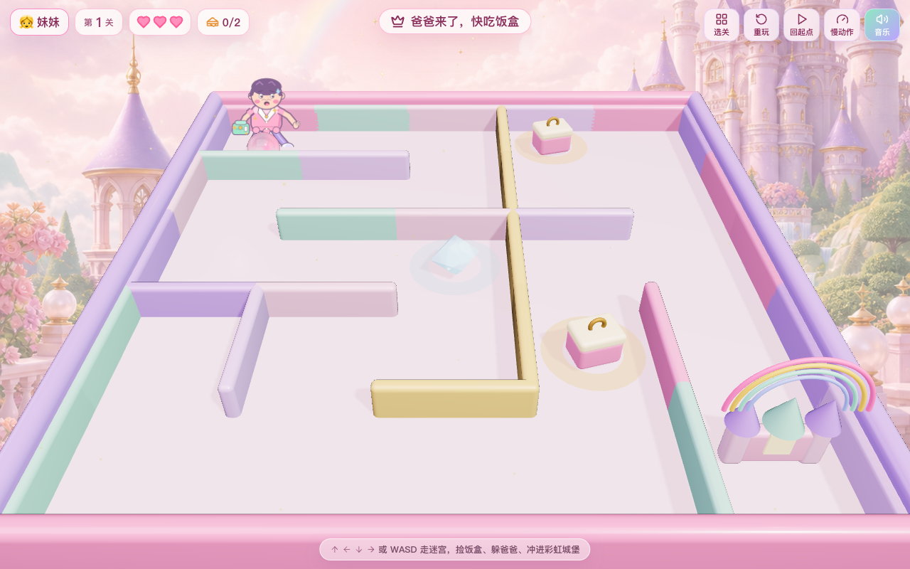
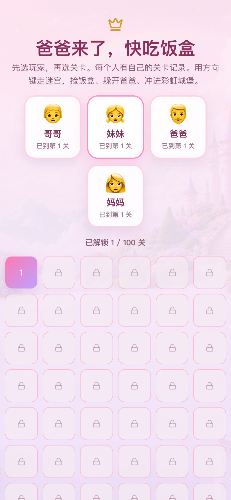

# 爸爸来了，快吃饭盒

给 6 岁女孩玩的公主风 3D 迷宫追逐游戏。在彩虹城堡迷宫里操控水晶珠，一边捡饭盒、一边躲开自动寻路追来的爸爸，冲进彩虹城堡过关。共 100 关，难度阶梯式递增。

> 前身是「梦幻公主水晶迷宫」（倾斜托盘滚珠子的物理迷宫）。本版把核心玩法改成直接操控 + 追逐者，保留了原来的迷宫生成、可解性验证、彩虹城堡终点和粉彩公主视觉。

线上版本：<https://challenwang.com/projects/baba-lai-le/>

## 运行

```bash
npm install
npm run dev
```

## 玩法

- 方向键 / `WASD`：直接操控水晶珠在迷宫里走。
- 目标：走到彩虹城堡过关。
- 爸爸（追逐者）：生在你的起点（身后），每关开局有几秒头部时间让你先跑。之后他**踩着你走过的脚印追**，不会抄近道堵在前面。只要一直往前走就能拉开距离；停下、走回头路或钻死胡同时他会迅速逼近。被追上扣一条命，三条命用完本关重来。
- 饭盒：路上的收集物，捡到记一分（不影响过关，纯奖励）。
- 冻结道具：捡到后爸爸被冻住几秒，趁机跑。
- 音乐：默认带舒缓循环背景音乐，首次点击关卡或音乐按钮后播放，可在 HUD 中关闭。
- 鼠标拖动空白处环绕相机，滚轮缩放，双击重置相机。
- 移动端：左下角方向键。

## 关卡与难度

- 100 关，进度存在 localStorage（key `pcm-progress`），通关自动解锁下一关。
- 难度随关数平滑递增：迷宫从 5×5 长到 15×15，爸爸变快（0.85→1.5 格/秒，始终低于珠子巡航速度以保证可过）、头部时间变短、饭盒变多。每关均已用最优走法验证可满血通关。
- 关卡选择页可挑任意已解锁关卡。

## 主要模块

- `src/game/store.ts`：游戏状态机（关卡 / 生命 / 阶段 / 冻结 / 道具）。
- `src/game/levels.ts`：100 关难度曲线 + 进度持久化。
- `src/game/pathfinding.ts`：迷宫网格 BFS 寻路（爸爸追人、撒道具用）。
- `src/components/Dad.tsx`：追逐者（寻路 + 抓到判定 + 冻结）。
- `src/components/Items.tsx`：饭盒和冻结道具。
- `src/game/audio.ts`：背景音乐单例播放控制，兼容浏览器用户手势限制。
- `src/maze/generator.ts`：种子迷宫生成 + BFS 可解性验证 + 坐标换算。

## 美术素材

- `public/assets/dad-chaser.png`：追逐者贴图（Codex imagegen 生成）。
- `public/assets/princess-sky-garden.png`：童话城堡花园背景。
- `public/assets/pearlescent-maze-floor.png`：珍珠迷宫地面纹理。
- `public/assets/crystal-marble-swirl.png`：水晶珠内部纹理。
- `public/assets/bgm-calm-loop.wav`：原创舒缓循环背景音乐。
- 道具使用轻量 3D 造型，不依赖贴图。

## 性能处理

线上曾出现拾取冻结道具时明显卡顿。根因是道具被拾取后卸载了包含动态 `pointLight` 的 React Three Fiber 子树，导致 Three.js 场景灯光数量变化。当前版本移除了道具内动态灯光，拾取后只隐藏节点，不再触发这类场景重建。

## 验证

```bash
npm run build
npm run verify:maze
```

`verify:maze` 会检查本次性能和音乐相关的关键约束：道具内不再有动态 `pointLight`，拾取后不卸载整棵 R3F 子树，BGM 资源存在且通过 `asset()` 引用，HUD 有音乐开关。

## 截图




